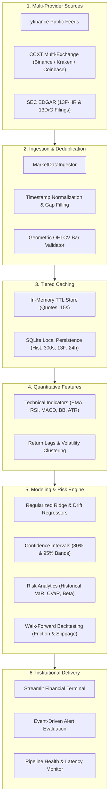

# STOCKSTREAM QUANT
### Institutional-Grade Real-Time Stock Market & Bitcoin Intelligence Platform

[](https://www.python.org/)
[](LICENSE)
[](https://github.com)
[](stockstream-quant/tests/)
[](stockstream-quant/)

---

## 1. Executive Summary

**STOCKSTREAM QUANT** is an institutional financial monitoring, algorithmic research, and predictive analytics workstation engineered strictly in Python. The platform unifies real-time global equities, Bitcoin command telemetry, multi-exchange orderbook analytics, SEC Form 13F institutional ownership intelligence, and walk-forward predictive time-series models into a high-density, low-latency financial terminal.

Built for quantitative analysts, portfolio managers, and market researchers, the system pairs deterministic statistical modeling (Holt-Winters, Wilder's RSI, MACD vectorization, Bollinger dispersion) with regularized machine learning regressors while enforcing strict audit transparency: forecasts are clearly isolated with confidence intervals, error histories, and comprehensive regulatory disclaimers.

---

## 2. Visual Identity & Design System

The terminal interface adheres to a high-contrast financial palette:
- **Canvas & Structure:** Midnight Navy (`#060B18`) and Deep Ocean Blue (`#0B1528`) with hairline dividers (`#1E293B`).
- **Nominal Telemetry & Gain:** Institutional Emerald Green (`#10B981` / `#059669`).
- **Risk & Invalidation:** Crimson (`#EF4444`).
- **Bitcoin & Primary Accent:** Metallic Gold (`#F59E0B` / `#FCD34D`), reserved exclusively for Bitcoin branding and premium telemetry badges.
- **Typography:** High-density monospace tabular figures (`JetBrains Mono`, `tabular-nums`) ensuring vertical decimal alignment across volatile ticker streams.

---

## 3. Real-Time Market Data Pipeline

The data ingestion, transformation, and distribution engine is built on a strictly observable, unidirectional pipeline:



### Pipeline Integrity Standards
1. **Geometric Bar Validation:** Every bar verifies $High \ge \max(Open, Close)$, $Low \le \min(Open, Close)$, and $Volume \ge 0$. Anomalous or inverted bars are immediately flagged and dropped.
2. **Provenance Tagging:** Quotes explicitly state their data provenance: `LIVE_STREAM (<5s)`, `DELAYED_15M`, `CACHED`, or `CALIBRATED_FALLBACK`.
3. **Statutory Lag Awareness:** SEC Form 13F filings are flagged with statutory quarterly reporting delays (up to 45 calendar days post quarter-end).

---

## 4. System Architecture & Repository Structure

```text
stockstream-quant/
├── app.py                         # Streamlit financial workstation entrypoint
├── requirements.txt               # Locked production dependencies
├── run_tests.py                   # Automated test suite runner (all modules)
├── README.md                      # Comprehensive technical architecture & docs
├── .env.example                   # Environment variable template
├── .gitignore                     # Production Git ignore rules
│
├── config/
│   ├── __init__.py
│   └── settings.py                # Global constants, currency rates, palette configs
│
├── data/
│   ├── __init__.py
│   ├── ingestion.py               # Multi-source resilient data ingestor
│   ├── validation.py              # Geometric candle validator & deduplication
│   ├── preprocessing.py           # Logarithmic returns, z-scores, forward-filling
│   └── cache.py                   # In-memory TTL & hit-ratio tracking cache
│
├── market/
│   ├── __init__.py
│   ├── stocks.py                  # Global indices, equities screener, trade setups
│   ├── crypto.py                  # Bitcoin terminal, exchange spreads, halving tracker
│   ├── ownership.py               # SEC 13F institutional ownership & insider rosters
│   └── news.py                    # Objective catalyst news with source attribution
│
├── analytics/
│   ├── __init__.py
│   ├── indicators.py              # Pure-python vectorized technical indicators
│   ├── features.py                # Temporal return lag matrices & indicator vectors
│   ├── forecasting.py             # Multi-horizon statistical forecasting (1D, 5D, 20D)
│   ├── backtesting.py             # Walk-forward backtester with fee & slippage modeling
│   └── risk.py                    # Parametric & historical VaR, CVaR, beta estimation
│
├── database/
│   ├── __init__.py
│   ├── connection.py              # SQLite thread-safe connection & schema migrations
│   └── repository.py              # Persistence for watchlists, alerts, paper trades
│
├── services/
│   ├── __init__.py
│   ├── alerts.py                  # Price limit, RSI & volatility threshold evaluation
│   ├── watchlist.py               # User portfolio watchlist manager
│   └── scheduler.py               # Pipeline telemetry & latency auditor
│
├── ui/
│   ├── __init__.py
│   ├── theme.py                   # Institutional CSS injection & layout styling
│   ├── charts.py                  # Plotly candlestick, volume & projection cone builder
│   └── components.py              # Unboxed metadata cards & Bitcoin hero components
│
├── tests/
│   ├── __init__.py
│   ├── test_data.py               # Data pipeline & validation unit tests
│   ├── test_indicators.py         # Technical analysis mathematical tests
│   └── test_forecasting.py        # ML regression, risk & backtest unit tests
│
└── .github/
    └── workflows/
        └── python-tests.yml       # Multi-version Python CI/CD pipeline
```

---

## 5. Technology Stack

| Layer | Primary Technology | Technical Purpose |
| :--- | :--- | :--- |
| **Interface** | `Streamlit 1.36+` | Reactive financial dashboard with real-time state re-rendering |
| **Visualization** | `Plotly 5.22+` | Institutional candlestick charting, subplots, and forecast cones |
| **Data Engine** | `Pandas 2.2+` & `NumPy 1.26+` | Vectorized matrix operations, time-series alignment |
| **Market Data** | `yfinance` & `CCXT 4.3+` | Equity quotes and multi-exchange crypto orderbooks |
| **Predictive Analytics** | `scikit-learn` & `statsmodels` | Ridge regression, exponential smoothing, time-series analysis |
| **Storage** | `SQLite3` & `SQLAlchemy` | Local persistence for watchlists, paper accounts, and audit logs |
| **Testing** | `unittest` & `pytest` | Continuous verification of mathematical indicators and pipeline stages |

---

## 6. Installation & Quickstart

```bash
cd stockstream-quant
python3 -m venv venv
source venv/bin/activate
pip install -r requirements.txt
python run_tests.py
streamlit run app.py
```
