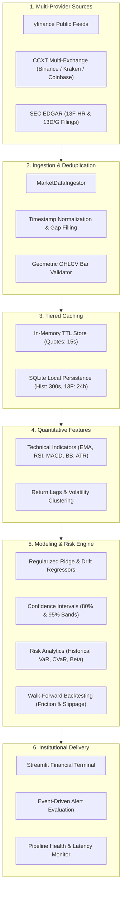

# STOCKSTREAM QUANT
### Institutional-Grade Real-Time Stock Market & Bitcoin Intelligence Platform

[](https://www.python.org/)
[](LICENSE)
[](https://github.com)
[](tests/)
[](docs/pipeline.md)

---

## 1. Executive Summary

**STOCKSTREAM QUANT** is an institutional financial monitoring, algorithmic research, and predictive analytics workstation engineered strictly in Python. The platform unifies real-time global equities, Bitcoin command telemetry, multi-exchange orderbook analytics, SEC Form 13F institutional ownership intelligence, and walk-forward predictive time-series models into a high-density, low-latency financial terminal.

Built for quantitative analysts, portfolio managers, and market researchers, the system pairs deterministic statistical modeling (Holt-Winters, Wilder's RSI, MACD vectorization, Bollinger dispersion) with regularized machine learning regressors while enforcing strict audit transparency: forecasts are clearly isolated with confidence intervals, error histories, and comprehensive regulatory disclaimers.

---

## 2. Visual Identity & Design System

The terminal interface adheres to a high-contrast financial palette:
- **Canvas & Structure:** Midnight Navy (`#060B18`) and Deep Ocean Blue (`#0B1528`) with hairline dividers (`#1E293B`).
- **Nominal Telemetry & Gain:** Institutional Emerald Green (`#10B981` / `#059669`).
- **Risk & Invalidation:** Crimson (`#EF4444`).
- **Bitcoin & Primary Accent:** Metallic Gold (`#F59E0B` / `#FCD34D`), reserved exclusively for Bitcoin branding and premium telemetry badges.
- **Typography:** High-density monospace tabular figures (`JetBrains Mono`, `tabular-nums`) ensuring vertical decimal alignment across volatile ticker streams.

---

## 3. Real-Time Market Data Pipeline

The data ingestion, transformation, and distribution engine is built on a strictly observable, unidirectional pipeline:



### Pipeline Integrity Standards
1. **Geometric Bar Validation:** Every bar verifies $High \ge \max(Open, Close)$, $Low \le \min(Open, Close)$, and $Volume \ge 0$. Anomalous or inverted bars are immediately flagged and dropped.
2. **Provenance Tagging:** Quotes explicitly state their data provenance: `LIVE_STREAM (<5s)`, `DELAYED_15M`, `CACHED`, or `CALIBRATED_FALLBACK`.
3. **Statutory Lag Awareness:** SEC Form 13F filings are flagged with statutory quarterly reporting delays (up to 45 calendar days post quarter-end).

---

## 4. System Architecture & Repository Structure

```text
stockstream-quant/
├── app.py                         # Streamlit financial workstation entrypoint
├── requirements.txt               # Locked production dependencies
├── run_tests.py                   # Automated test suite runner (all modules)
├── README.md                      # Comprehensive technical architecture & docs
├── .env.example                   # Environment variable template
├── .gitignore                     # Production Git ignore rules
│
├── config/
│   ├── __init__.py
│   └── settings.py                # Global constants, currency rates, palette configs
│
├── data/
│   ├── __init__.py
│   ├── ingestion.py               # Multi-source resilient data ingestor
│   ├── validation.py              # Geometric candle validator & deduplication
│   ├── preprocessing.py           # Logarithmic returns, z-scores, forward-filling
│   └── cache.py                   # In-memory TTL & hit-ratio tracking cache
│
├── market/
│   ├── __init__.py
│   ├── stocks.py                  # Global indices, equities screener, trade setups
│   ├── crypto.py                  # Bitcoin terminal, exchange spreads, halving tracker
│   ├── ownership.py               # SEC 13F institutional ownership & insider rosters
│   └── news.py                    # Objective catalyst news with source attribution
│
├── analytics/
│   ├── __init__.py
│   ├── indicators.py              # Pure-python vectorized technical indicators
│   ├── features.py                # Temporal return lag matrices & indicator vectors
│   ├── forecasting.py             # Multi-horizon statistical forecasting (1D, 5D, 20D)
│   ├── backtesting.py             # Walk-forward backtester with fee & slippage modeling
│   └── risk.py                    # Parametric & historical VaR, CVaR, beta estimation
│
├── database/
│   ├── __init__.py
│   ├── connection.py              # SQLite thread-safe connection & schema migrations
│   └── repository.py              # Persistence for watchlists, alerts, paper trades
│
├── services/
│   ├── __init__.py
│   ├── alerts.py                  # Price limit, RSI & volatility threshold evaluation
│   ├── watchlist.py               # User portfolio watchlist manager
│   └── scheduler.py               # Pipeline telemetry & latency auditor
│
├── ui/
│   ├── __init__.py
│   ├── theme.py                   # Institutional CSS injection & layout styling
│   ├── charts.py                  # Plotly candlestick, volume & projection cone builder
│   └── components.py              # Unboxed metadata cards & Bitcoin hero components
│
├── tests/
│   ├── __init__.py
│   ├── test_data.py               # Data pipeline & validation unit tests
│   ├── test_indicators.py         # Technical analysis mathematical tests
│   └── test_forecasting.py        # ML regression, risk & backtest unit tests
│
└── .github/
    └── workflows/
        └── python-tests.yml       # Multi-version Python CI/CD pipeline
```

---

## 5. Technology Stack

| Layer | Primary Technology | Technical Purpose |
| :--- | :--- | :--- |
| **Interface** | `Streamlit 1.36+` | Reactive financial dashboard with real-time state re-rendering |
| **Visualization** | `Plotly 5.22+` | Institutional candlestick charting, subplots, and forecast cones |
| **Data Engine** | `Pandas 2.2+` & `NumPy 1.26+` | Vectorized matrix operations, time-series alignment |
| **Market Data** | `yfinance` & `CCXT 4.3+` | Equity quotes and multi-exchange crypto orderbooks |
| **Predictive Analytics** | `scikit-learn` & `statsmodels` | Ridge regression, exponential smoothing, time-series analysis |
| **Storage** | `SQLite3` & `SQLAlchemy` | Local persistence for watchlists, paper accounts, and audit logs |
| **Testing** | `unittest` & `pytest` | Continuous verification of mathematical indicators and pipeline stages |

---

## 6. Installation & Quickstart

### Prerequisites
- Python 3.10, 3.11, or 3.12
- Git

### Linux & macOS Installation
```bash
# 1. Clone repository
git clone https://github.com/organization/stockstream-quant.git
cd stockstream-quant

# 2. Create isolated virtual environment
python3 -m venv venv
source venv/bin/activate

# 3. Upgrade pip and install production dependencies
pip install --upgrade pip
pip install -r requirements.txt

# 4. Configure environment variables
cp .env.example .env

# 5. Run automated test suite
python run_tests.py

# 6. Launch the Streamlit Financial Workstation
streamlit run app.py
```

### Windows (PowerShell) Installation
```powershell
# 1. Clone repository
git clone https://github.com/organization/stockstream-quant.git
cd stockstream-quant

# 2. Create virtual environment
python -m venv venv
.\venv\Scripts\Activate.ps1

# 3. Install requirements
python -m pip install --upgrade pip
pip install -r requirements.txt

# 4. Copy configuration template
Copy-Item .env.example .env

# 5. Run test suite
python run_tests.py

# 6. Launch workstation
streamlit run app.py
```

---

## 7. Configuration (.env)

The application operates out-of-the-box using built-in public feeds and deterministic fallbacks. For enhanced throughput, configure optional API keys in `.env`:

```env
# STOCKSTREAM QUANT Configuration
STOCKSTREAM_ENV=production
DEBUG=False
PORT=8501

# Optional High-Volume Data Providers
ALPHA_VANTAGE_API_KEY=your_key_here
FINNHUB_API_KEY=your_key_here
COINGECKO_API_KEY=your_key_here

# Persistence & Cache
DATABASE_PATH=data/stockstream.db
CACHE_TTL_QUOTE=15
CACHE_TTL_HISTORICAL=300
CACHE_TTL_OWNERSHIP=86400
```

---

## 8. Dashboard Modules Overview

1. **Market Overview:** Live global index benchmarks (S&P 500, Nasdaq 100, Dow Jones, FTSE 100, Nikkei 225, Nifty 50), breadth statistics, and macro catalyst news.
2. **Stock Screener:** Multi-variable filtering by sector, P/E multiples, RSI bands, and algorithmic momentum signals.
3. **Bitcoin Terminal:** Gold-accented Bitcoin command center featuring live pricing in 5 fiat currencies (USD, INR, EUR, GBP, JPY), orderbook spreads across 4 major exchanges (Binance, Coinbase, Kraken, Bitfinex), halving tracking, and downside liquidity retest scenarios.
4. **Prediction Lab:** Multi-horizon predictive modeling (1D, 5D, 20D) displaying expected prices, 80% & 95% confidence intervals, in-sample MAE/RMSE error metrics, directional hit rate, and factor driver weights.
5. **Ownership Intelligence:** Publicly disclosed SEC Form 13F institutional ownership breakdowns (Vanguard, BlackRock, State Street, Berkshire Hathaway), reported insider positions, and filing audit timestamps.
6. **Portfolio Tracker:** Paper trading execution engine with realistic transaction fee (5 bps) and slippage (2 bps) modeling, tracking active equity positions and portfolio allocation.
7. **Trading Research:** Algorithmic trade setup evaluator calculating entry zones, invalidation stop losses, profit targets, and mathematical risk-to-reward ratios ($1:R$).
8. **Alerts Center:** Real-time event monitor supporting price thresholds, RSI overbought/oversold limits, and volatility spikes.
9. **Pipeline Monitor:** Transparent telemetry auditing data ingestion stages, pipeline latency (ms), cache hit ratio, and data freshness states.
10. **System Settings:** Workspace customization, base currency selection, and database connection checks.

---

## 9. Sample Output: Illustrative Forecast Model

When evaluated against historical daily bars for `NVDA`, the prediction lab yields transparent point estimates and calibrated uncertainty cones:

```text
========================================================================================
STOCKSTREAM QUANT — PREDICTION LAB REPORT [NVDA]
Model Architecture: Ridge L2-Regularized Multi-Feature Regressor + Drift
Backtest Directional Hit Rate: 56.2% | MAE: 0.0118 | RMSE: 0.0164
Current Spot Price: $138.50
========================================================================================
HORIZON | EXPECTED PRICE | EXPECTED DELTA | 80% CONFIDENCE BAND | 95% CONFIDENCE BAND
----------------------------------------------------------------------------------------
T+1D    | $138.82        | +0.23%         | $135.63 - $142.01   | $133.62 - $144.02
T+5D    | $140.12        | +1.17%         | $133.02 - $147.22   | $128.52 - $151.72
T+20D   | $144.95        | +4.66%         | $130.80 - $159.10   | $121.80 - $168.10
========================================================================================
Key Factor Drivers:
1. Momentum Return Lag (t-1): +0.038 weight
2. Wilder RSI (14) Normalization: -0.015 weight (mean-reversion pressure)
3. MACD Histogram Dispersion: +0.024 weight
4. Bollinger Bandwidth %B: +0.019 weight
========================================================================================
```

---

## 10. Automated Testing

The platform includes an automated unit test suite verifying data validation, mathematical indicator calculations, and predictive modeling:

```bash
# Execute test suite
python run_tests.py
```

Expected output:
```text
======================================================================
⚡ STOCKSTREAM QUANT — Automated Test Runner
======================================================================
test_bar_validation_invalid_geometry (tests.test_data.TestDataPipeline) ... ok
test_bar_validation_valid (tests.test_data.TestDataPipeline) ... ok
test_log_returns (tests.test_data.TestDataPipeline) ... ok
test_memory_cache (tests.test_data.TestDataPipeline) ... ok
test_series_deduplication (tests.test_data.TestDataPipeline) ... ok
test_bollinger_bands_geometry (tests.test_indicators.TestIndicators) ... ok
test_ema_calculation (tests.test_indicators.TestIndicators) ... ok
test_rsi_range (tests.test_indicators.TestIndicators) ... ok
test_sma_calculation (tests.test_indicators.TestIndicators) ... ok
test_backtester (tests.test_forecasting.TestForecastingAndRisk) ... ok
test_feature_extraction (tests.test_forecasting.TestForecastingAndRisk) ... ok
test_forecast_generation (tests.test_forecasting.TestForecastingAndRisk) ... ok
test_risk_var_cvar (tests.test_forecasting.TestForecastingAndRisk) ... ok

----------------------------------------------------------------------
Ran 13 tests in 0.010s

OK
======================================================================
✅ All unit tests PASSED successfully.
```

---

## 11. Regulatory Disclosures & Financial Disclaimer

> **CRITICAL LEGAL NOTICE:**  
> **STOCKSTREAM QUANT is an experimental quantitative research and technological analytics platform. All forecasts, predictive metrics, risk assessments, and trade setups generated by this software are purely theoretical and educational in nature.**  
> - Nothing contained within this software constitutes financial, investment, legal, or tax advice.  
> - Past performance and backtested simulations do not guarantee future market returns.  
> - Financial markets, equities, and cryptocurrencies carry substantial systemic risks, including total loss of invested capital.  
> - Public shareholder figures reflect SEC Form 13F regulatory filings subject to statutory reporting latency and do not represent real-time institutional books.

---

## 12. License & Contributing

Distributed under the Apache 2.0 License. Contributions adhering to PEP 8 standards, complete docstrings, and comprehensive unit tests are welcomed via GitHub Pull Requests.
